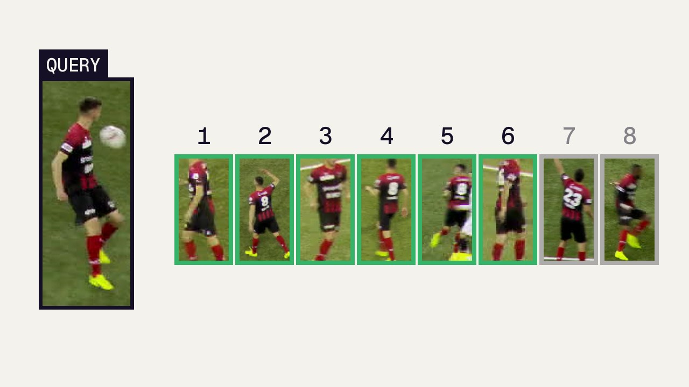
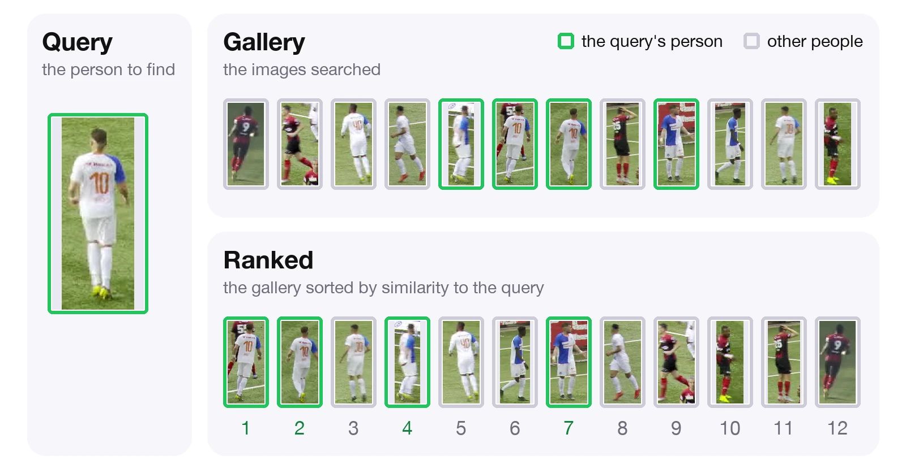

<div align="center">
    <h1>reid</h1>
    <p>Load and evaluate person re-identification models in Python.</p>

[](https://badge.fury.io/py/reid) [](https://pypistats.org/packages/reid) [](LICENSE) [](https://badge.fury.io/py/reid) [](https://discord.gg/GbfgXGJ8Bk)

</div>

`reid` turns a person crop into an appearance embedding, a vector that is close for crops of the same person and far apart for different people. It loads pretrained OSNet and FastReID checkpoints, embeds `supervision.Detections` from any detector or crops saved on disk, and measures how well a model matches people: across cameras with retrieval on Market-1501 and MSMT17, or over time with re-association on crops cut from MOT-format video. Requires Python 3.10 or newer.

https://github.com/user-attachments/assets/68fe0a58-1414-4776-a4a0-412cbcb68643

Gallery retrieval with `osnet_x1_0_msmt17_combineall`: crops ranked by cosine distance to a query player, closest first. The other [pretrained models](#pretrained-models) work the same way.

Read the [documentation](https://reid.roboflow.com/) for guides and the API reference.

## Install

```bash
pip install -U reid
```

<details>
<summary>Install from source</summary>

```bash
pip install git+https://github.com/roboflow/re-ID.git
```

For development, clone the repository and run `uv sync --all-extras` or `pip install -e ".[dev]"`.

</details>

## Quick start

`extract_embeddings` computes one embedding for each bounding box in a frame. Pass the boxes as `sv.Detections`, which you can get from a detector like [RF-DETR](https://github.com/roboflow/rf-detr). Below, two people are boxed in the first frame of a sample video. `from_pretrained` downloads the model you name, here OSNet x1.0 trained on MSMT17.

```python
import numpy as np
import supervision as sv
from supervision.assets import VideoAssets, download_assets
from reid import ReIDModel

model = ReIDModel.from_pretrained("osnet_x1_0_msmt17_combineall")

frame = next(sv.get_video_frames_generator(download_assets(VideoAssets.PEOPLE_WALKING)))
detections = sv.Detections(xyxy=np.array([[746, 446, 828, 628], [1136, 502, 1214, 660]], dtype=np.float32))
embeddings = model.extract_embeddings(detections, frame)

embeddings.shape
# (2, 512)
```

Crops already saved as images work the same way:

```python
embeddings = model.extract_embeddings_from_paths(["crop_1.jpg", "crop_2.jpg"])
```

For every way to load a model, including saved models, Hugging Face repositories, and weights files, see the [loading guide](docs/guides/loading.md).

There are two ways to build a model: `ReIDModel.from_pretrained("osnet_x1_0_msmt17_combineall")` loads trained weights, and `ReIDModel("osnet_x1_0")` builds the architecture with random weights.

## Evaluate

`model.evaluate` scores a model on benchmark splits or on your own identity folders, one folder of crops per person.

```python
from reid import ReIDModel, load_identity_folders, load_market1501

model = ReIDModel.from_pretrained("osnet_x1_0_msmt17_combineall")

query, gallery = load_market1501("/path/to/Market-1501")
result = model.evaluate(query, gallery)

result = model.evaluate(load_identity_folders("/path/to/identity/folders"))
result.metrics
# {'map': ..., 'rank1': ..., 'rank5': ..., 'rank10': ..., 'minp': ...}
```

For crops cut from video, `ReassociationProtocol` asks whether the model recognizes a person a set number of frames later, the way a tracker uses it. See the [evaluation guide](docs/guides/evaluation.md) and the [metric definitions](docs/learn/metrics.md).

## Pretrained models

| Name                           | Architecture             | Trained on                          | Use for                                                                                         |
| :----------------------------- | :----------------------- | :---------------------------------- | :---------------------------------------------------------------------------------------------- |
| `osnet_x1_0_msmt17_combineall` | OSNet x1.0               | MSMT17, all splits combined         | General pedestrian embeddings. Not for evaluating on MSMT17, whose test identities it has seen. |
| `fastreid_mot17_sbs50`         | FastReID SBS, ResNeSt-50 | MOT17 train-half ground-truth crops | MOT17 tracking, as in BoT-SORT                                                                  |
| `osnet_x1_0_mot17`             | OSNet x1.0               | MOT17 train-half crops              | Tracking pedestrians, as in MOT17                                                               |
| `osnet_x1_0_sportsmot`         | OSNet x1.0               | SportsMOT train crops               | Tracking basketball, football and volleyball players, as in SportsMOT                           |
| `osnet_x1_0_dancetrack`        | OSNet x1.0               | DanceTrack train crops              | Tracking dancers in similar outfits, as in DanceTrack                                           |
| `osnet_x1_0_soccernet`         | OSNet x1.0               | SoccerNet train crops               | Tracking soccer players, as in SoccerNet                                                        |

`list_aliases()` lists these names. Any `timm:<name>` backbone and other OSNet sizes load from a weights file; see the [loading guide](docs/guides/loading.md).

## Tutorials

<p align="left">
<a href="https://colab.research.google.com/github/roboflow/re-ID/blob/main/docs/cookbooks/how-to-use-reid.ipynb"></a>
<a href="https://colab.research.google.com/github/roboflow/re-ID/blob/main/docs/cookbooks/how-to-use-reid.ipynb"><strong>How to Use Re-ID</strong></a>
<br/>Load a model, match the boxes of a MOT17 frame to a later frame with <code>distance_matrix</code>, see identities cluster, and evaluate with retrieval and re-association.
<br/><br/><a href="https://colab.research.google.com/github/roboflow/re-ID/blob/main/docs/cookbooks/how-to-use-reid.ipynb"></a>
</p>
<br clear="left"/>

<p align="left">
<a href="https://colab.research.google.com/github/roboflow/re-ID/blob/main/docs/cookbooks/how-to-benchmark-reid-models.ipynb"></a>
<a href="https://colab.research.google.com/github/roboflow/re-ID/blob/main/docs/cookbooks/how-to-benchmark-reid-models.ipynb"><strong>How to Benchmark Re-ID Models</strong></a>
<br/>Evaluate OSNet x1.0 on Market-1501 and MSMT17 and compare against the torchreid model zoo.
<br/><br/><a href="https://colab.research.google.com/github/roboflow/re-ID/blob/main/docs/cookbooks/how-to-benchmark-reid-models.ipynb"></a>
</p>
<br clear="left"/>

## Guides

| Guide                                           | What you will do                                                                                               |
| :---------------------------------------------- | :------------------------------------------------------------------------------------------------------------- |
| [Load a model](docs/guides/loading.md)          | Load pretrained names, saved models, Hugging Face repositories, and weights files, and set image preprocessing |
| [Evaluate a model](docs/guides/evaluation.md)   | Score a model on Market-1501, your own identity folders, or crops cut from video                               |
| [Understand the metrics](docs/learn/metrics.md) | Read mAP, rank-k, mINP, and MRR, and see why tracking needs re-association                                     |

## Citation

If you use `reid` in academic work, please cite the library:

<details>
<summary>BibTeX</summary>

```bibtex
@software{roboflow_reid,
  author  = {{Roboflow}},
  title   = {Roboflow Re-ID},
  url     = {https://github.com/roboflow/re-ID},
  year    = {2026},
  license = {Apache-2.0}
}
```

</details>

For the models themselves, cite OSNet ([Zhou et al., ICCV 2019](https://arxiv.org/abs/1905.00953)) and FastReID ([He et al., 2020](https://arxiv.org/abs/2006.02631)).

## License

The code is released under the [Apache 2.0 license](LICENSE).
