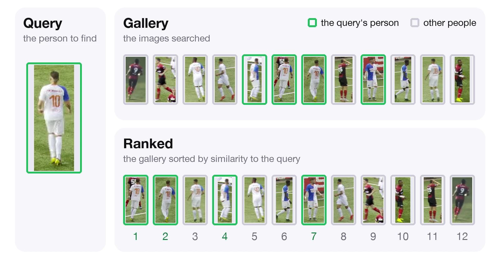
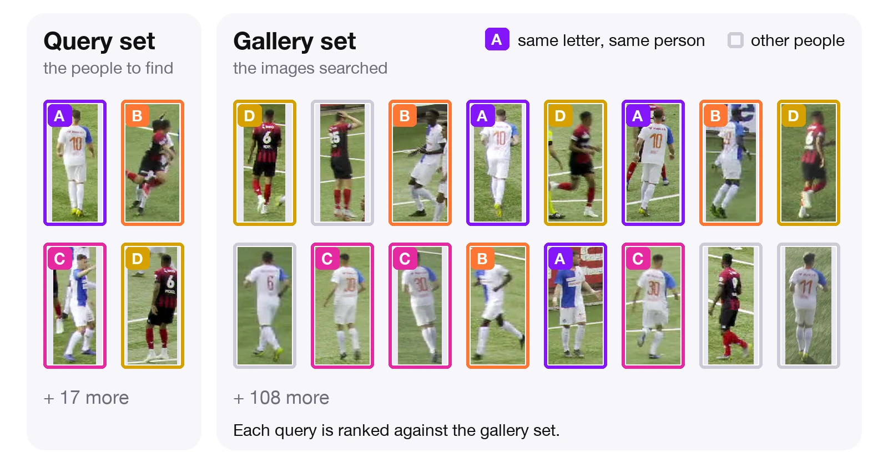

# Evaluate a model

`ReIDModel.evaluate` measures how accurately a model matches people. [How evaluation works](#how-evaluation-works) explains what is compared; the sections after it show the code.

## How evaluation works

### Query and gallery

Re-ID works as a search. The crop of the person you want to find is the **query**, and the crops you search are the **gallery**. The model ranks the gallery by the distance of each crop to the query, closest first. A good model ranks the gallery crops of the same person at the top.



<p align="center" style="margin-top: -0.4em;"><small>One query from a SoccerNet clip, ranked by the default model against 12 crops from the game's other clips. The query's person lands at ranks 1, 2, 4, and 7. Which images the gallery holds depends on the evaluation setup.</small></p>

### Query set and gallery set

To measure a model, you repeat that search for many people. The test images are split into a **query set** and a **gallery set**: Market-1501 and MSMT17 ship this split, and for your own identity folders `RetrievalProtocol` takes one query image of each person with at least two images and puts their other images in the gallery set. Each query is ranked against the whole gallery set, and the [metrics](../learn/metrics.md) summarize how high the correct matches land.



<p align="center" style="margin-top: -0.4em;"><small><code>RetrievalProtocol</code> with its defaults on SoccerNet identity folders: one query for each of the 21 people with at least two images, ranked against their other 124 images.</small></p>

Whether a gallery image is a match, a distractor, or junk is decided for each query, so the same image can count differently for two queries. An image of person 5 from camera 1 is junk for a query of person 5 from camera 1, and a match for a query of person 5 from camera 2.

| Term       | Meaning                                                                                         |
| :--------- | :---------------------------------------------------------------------------------------------- |
| Match      | Gallery image of the query's person from a different camera                                     |
| Distractor | Gallery image of anyone else; it counts as a wrong candidate                                    |
| Junk       | Gallery image ignored when ranking: the query's person from the same camera, or a bad detection |

Junk entries are removed from the query's ranked list before scoring. They never count as hits or as wrong candidates that push a hit down the ranking. Same-camera images of the query's person are junk because the goal is to find the person in other cameras.

### Distance

The distance between two embeddings can be computed in more than one way. Both protocols take a `distance` argument, as in `RetrievalProtocol(distance=...)`:

| `distance`           | Behavior                                        |
| :------------------- | :---------------------------------------------- |
| `"cosine"` (default) | Cosine distance after L2-normalizing embeddings |
| `"euclidean"`        | Euclidean distance on the raw embedding vectors |

Rankings, and so metrics, change with the distance, so use the same one for every run you compare, and the one a published table used when you compare against it.

```python
from reid.eval import RetrievalProtocol

result = model.evaluate(query, gallery, protocol=RetrievalProtocol(distance="euclidean"))
print(result.metrics)
```

Outside an evaluation, for example to find each person again in a later frame, `distance_matrix` computes the same distances between embeddings you extracted yourself: one row per query, smaller is closer.

```python
from reid import distance_matrix

query_embeddings = model.extract_embeddings(detections, frame)
gallery_embeddings = model.extract_embeddings(later_detections, later_frame)
closest = distance_matrix(query_embeddings, gallery_embeddings).argmin(axis=1)  # later_detections must not be empty
```

### Retrieval or re-association

Evaluate a model the way you will use it: the queries and gallery should look like the comparisons the model makes in your application.

- **Retrieval** asks whether the model finds a person in other cameras. Market-1501 and MSMT17 measure this, and `RetrievalProtocol` does it on your own identity folders.
- **Re-association** asks whether the model finds a person again a number of frames later in the same video. When Re-ID helps a tracker such as [Roboflow Trackers](https://github.com/roboflow/trackers) associate people across frames, this is the comparison it makes. `ReassociationProtocol` takes a person's crop at one frame as the query, ranks the people who have a crop in the same sequence a set number of frames later, and records the rank of that same person. Retrieval on the same crops would overstate this ability, because a query's closest gallery images are usually the same person a few frames apart.

## Evaluate on a benchmark or your own images

Market-1501 and MSMT17 provide their own query and gallery splits; pass these directly to the model.

```python
from reid import ReIDModel, load_market1501

model = ReIDModel.from_pretrained()
query, gallery = load_market1501("/path/to/Market-1501")
result = model.evaluate(query, gallery)

print(result.metrics)
# {'map': ..., 'rank1': ..., 'rank5': ..., 'rank10': ..., 'minp': ...}
print(result.num_queries)
# 3368
```

To evaluate your own images, either arrange them like Market-1501 or MSMT17 and load them with `load_market1501` or `load_msmt17`, or put them in identity folders, one per person (`<root>/<identity>/<image>.jpg`), and load them with `load_identity_folders`. `RetrievalProtocol` then splits them: it picks `queries_per_id` random images of each person as queries, using `seed`, and puts the rest in the gallery, so every query has a correct match to find. People with fewer than `min_crops` images are left out:

```python
from reid import load_identity_folders
from reid.eval import RetrievalProtocol

data = load_identity_folders("/path/to/identity/folders")

result = model.evaluate(data, protocol=RetrievalProtocol(queries_per_id=2, min_crops=3, seed=7))
```

Omit `protocol` to use retrieval with one query per identity. The same data and protocol, including its `seed`, always select the same images, so evaluating several models this way compares them on identical inputs. `RetrievalProtocol(...).build_query_gallery(data)` returns the query and gallery images it evaluates, the candidate mask (`None` for retrieval), and the metadata. To compare query and gallery images you chose yourself, build a `ReIDSplit` for each and pass both to `model.evaluate`.

`result.metrics` is a dictionary with metric names as keys and percentages as values. For retrieval, `map` (mean average precision) measures ranking across all correct matches, `rank1`, `rank5`, and `rank10` report the percentage of queries with a correct match among the 1, 5, or 10 gallery images closest to the query, and `minp` (mean inverse negative penalty) reflects the position of the last correct match. Re-association reports `rank1` and `mrr` instead, described [below](#crops-from-video). [Re-ID metrics](../learn/metrics.md#metrics) gives each metric's formula. `result.num_queries` counts queries included in the metrics; `result.metadata` records the protocol settings and the number of query and gallery images.

Retrieval uses cosine distance by default; set `RetrievalProtocol(distance="euclidean")` when the benchmark specifies Euclidean distance. Evaluation keeps the whole query-by-gallery distance matrix in memory, 4 bytes per pair, so check the size before evaluating a large dataset: MSMT17's official split, 11,659 queries by 82,161 gallery images, needs about 3.8 GB.

## Crops from video

[Re-association](#retrieval-or-re-association) evaluates crops cut from video. `generate_mot_patches` builds its input from sequences with MOT-format ground truth (a `gt/gt.txt` file and an `img1/` frame folder per sequence): one folder per identity (`<sequence>_<track_id>`) with one crop per box, named by frame.

```python
from reid import load_identity_folders
from reid.data.mot import generate_mot_patches
from reid.eval import ReassociationProtocol

generate_mot_patches(mot_root="/path/to/dancetrack/val", output_dir="/path/to/crops", split="full")

crops = load_identity_folders("/path/to/crops")
result = model.evaluate(crops, protocol=ReassociationProtocol(gap_frames=30, query_stride=60))
print(result.metrics)
```

`split` chooses which frames of each sequence are cropped:

| `split`                  | Frames cropped                                                     |
| :----------------------- | :----------------------------------------------------------------- |
| `"full"`                 | every frame                                                        |
| `"train_half"` (default) | frames 1 to L // 2 + 1 of a sequence of L frames (1 to 451 of 900) |
| `"val_half"`             | the remaining frames, L // 2 + 2 to L (452 to 900 of 900)          |

This is the MOT17 half split used in the tracking literature, for example by ByteTrack, so the train half has one frame more than the val half when L is even.

Use `"full"` for sequences kept only for evaluation. Use `"train_half"` and `"val_half"` when training and evaluating on the same sequences, so no frame is used for both. Boxes with confidence 0, which MOTChallenge ground truth uses to mark boxes to ignore, are always skipped. Among the boxes with a nonzero confidence, `class_ids` keeps only the listed ground-truth classes.

Re-association reports `rank1`, the percentage of queries whose correct match is the closest of their candidates, and `mrr`, the [mean reciprocal rank](../learn/metrics.md#mrr): each query scores 1/r, where r is the rank of its correct match (1 at rank 1, 1/2 at rank 2), and `mrr` averages these scores. Each query has exactly one correct match, so mean average precision is the mean reciprocal rank.

Re-association scores rankings of saved crops; it does not run a tracker or decide any match. Set `gap_frames` to the gaps your tracker has to bridge, and measure tracking performance separately with [Roboflow Trackers](https://github.com/roboflow/trackers).

## Limit which gallery images each query is ranked against

By default, each query is ranked against the whole gallery. A candidate set limits a query to some of the gallery images. `ReassociationProtocol` builds one for every query: with `gap_frames=30`, a query at frame 100 is ranked only against the crops at frame 130 of the same sequence. People without a crop there, such as someone whose box the visibility or size filters dropped, are not candidates, and a query whose own person has no crop there is skipped.

To define your own candidate sets, subclass a protocol and return a candidate mask from `_build_query_gallery`. The mask is a boolean array shaped `(num_queries, num_gallery)`: `True` keeps a gallery image in that query's ranking, and `False` removes it from both the ranking and the count of correct matches. This protocol ranks each query only against gallery images from the same scene:

```python
import numpy as np

from reid.eval import RetrievalProtocol


class SameSceneRetrieval(RetrievalProtocol):
    def __init__(self, scene_of, **kwargs):
        super().__init__(**kwargs)
        self.scene_of = scene_of

    def _build_query_gallery(self, data, gallery=None):
        query, gallery, _, metadata = super()._build_query_gallery(data, gallery)
        query_scenes = np.array([self.scene_of[path] for path in query.image_paths])
        gallery_scenes = np.array([self.scene_of[path] for path in gallery.image_paths])
        return query, gallery, query_scenes[:, None] == gallery_scenes[None, :], metadata


result = model.evaluate(data, protocol=SameSceneRetrieval(scene_of))
```

Camera and junk-ID filtering still apply inside the candidate set. Set `exclude_same_pid_camid = False` on the class when same-person, same-camera matches should count, as in re-association. Queries with no correct match among their candidates are left out of the averages and of `num_queries`; if no query can be scored, `evaluate` raises a `ValueError`. The distance matrix is still computed in full, including the pairs outside the candidate sets, so it takes the same memory as without a mask.
