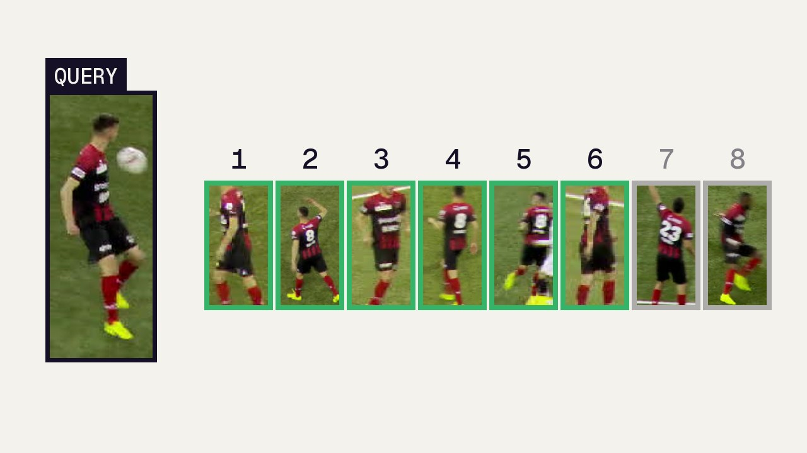
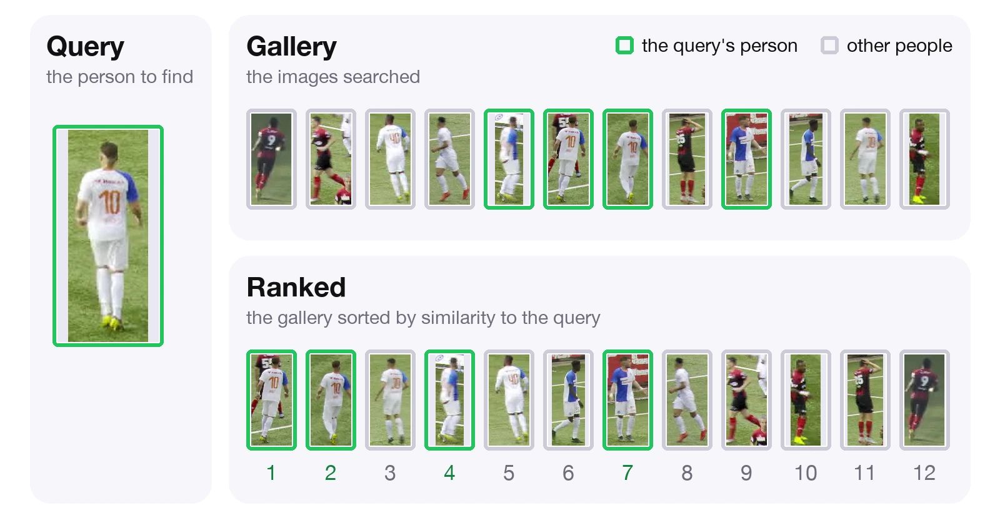

# Re-ID

Re-ID provides tools to load and evaluate re-identification models. Extract appearance embeddings from cropped images or detection boxes, and compare model performance with retrieval and re-association protocols.

Person re-identification (Re-ID) recognizes the same person in different images: in another camera, or later in a video after they were out of view. A Re-ID model turns each crop of a person into an embedding, a vector of numbers. Crops of the same person get embeddings that are close together and crops of different people get embeddings far apart, so the distance between two embeddings tells how likely the two crops show the same person.

<video width="100%" style="aspect-ratio: 16/9;" controls muted loop preload="none" poster="assets/reid-gallery-retrieval-poster.webp" aria-label="Gallery retrieval with the default Re-ID model">
  <source src="assets/reid-gallery-retrieval.mp4" type="video/mp4">
</video>

<p align="center" style="margin-top: -0.4em;"><small>Gallery retrieval with the default model, <code>osnet_x1_0_msmt17_combineall</code>: crops ranked by cosine distance to a query player, closest first.</small></p>

---

## Install

```bash
pip install reid
```

## Quickstart

```python
import numpy as np
import supervision as sv
from reid import ReIDModel

# Random weights for this API example; load a pretrained model for actual matching.
model = ReIDModel.from_pretrained(architecture="osnet_x0_25", device="cpu")
frame = np.zeros((256, 128, 3), dtype=np.uint8)
detections = sv.Detections(xyxy=np.array([[0, 0, 128, 256]], dtype=np.float32))
embeddings = model.extract_embeddings(detections, frame)

print(embeddings.shape)  # (1, 512)
```

## Guides

- [Load a model](guides/loading.md): use pretrained weights or load a saved model
- [Evaluate a model](guides/evaluation.md): how a query is ranked against a gallery, and how to measure a model's accuracy
- [Re-ID metrics](learn/metrics.md): understand Rank-k, mAP, mINP, and MRR

## Tutorials

<div class="grid cards" markdown>

- **How to Use Re-ID**

    ---

    <a href="https://colab.research.google.com/github/roboflow/re-ID/blob/main/docs/cookbooks/how-to-use-reid.ipynb"></a>

    Load a model, match the boxes of a MOT17 frame to a later frame with `distance_matrix`, see identities cluster, and evaluate with retrieval and re-association.

    [:simple-googlecolab: Run Google Colab](https://colab.research.google.com/github/roboflow/re-ID/blob/main/docs/cookbooks/how-to-use-reid.ipynb)

- **How to Benchmark Re-ID Models**

    ---

    <a href="https://colab.research.google.com/github/roboflow/re-ID/blob/main/docs/cookbooks/how-to-benchmark-reid-models.ipynb"></a>

    Evaluate OSNet x1.0 on Market-1501 and MSMT17 and compare against the torchreid model zoo.

    [:simple-googlecolab: Run Google Colab](https://colab.research.google.com/github/roboflow/re-ID/blob/main/docs/cookbooks/how-to-benchmark-reid-models.ipynb)

</div>
