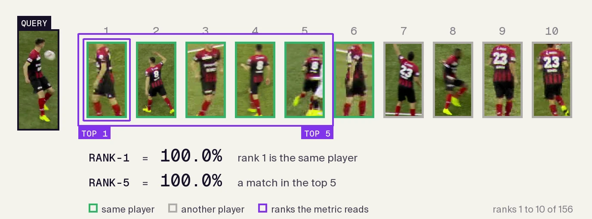
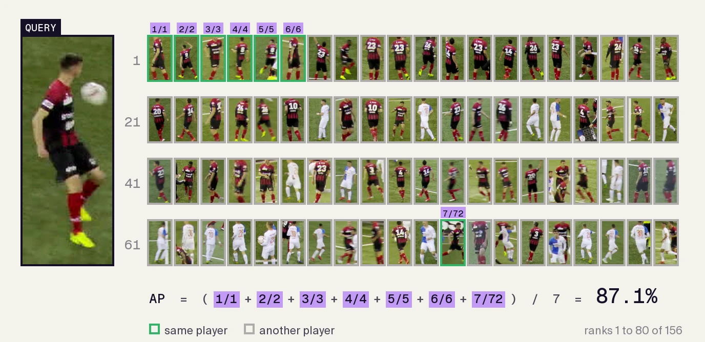
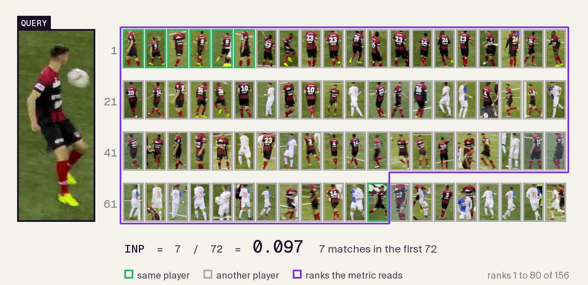

# Re-ID Metrics

Re-ID metrics measure how well a model finds images of the same person among candidate images. Standard retrieval benchmarks such as Market-1501 and MSMT17 test matching across cameras. Re-association evaluation tests matching within a sequence across a specified frame gap. [How evaluation works](../guides/evaluation.md#how-evaluation-works) explains how Re-ID test data is split into query and gallery images, and which gallery images count as matches.

**What you'll learn:**

- What Rank-k (CMC), mAP, mINP, and MRR measure, and how each is computed
- How to evaluate a model with `ReIDModel.evaluate`

---

## Quickstart

Evaluate a pretrained model on the Market-1501 query and gallery splits:

```python
from reid import ReIDModel, load_market1501

model = ReIDModel.from_pretrained("osnet_x1_0_msmt17_combineall")
query, gallery = load_market1501("/path/to/Market-1501-v15.09.15")
result = model.evaluate(query, gallery)
print(result.metrics)
print(result.num_queries)
```

Metrics are percentages. A typical result looks like:

```text
{'map': ..., 'rank1': ..., 'rank5': ..., 'rank10': ..., 'minp': ...}
3368
```

`osnet_x1_0_msmt17_combineall` was trained on MSMT17, so these Market-1501 numbers measure cross-domain transfer; [Benchmarks](#benchmarks) shows how to reproduce the published same-domain results.

---

## Metrics

For each query, the model compares the query's embedding with every gallery image's embedding using the chosen [distance](../guides/evaluation.md#distance), and sorts the gallery from closest to farthest. An image's **rank** is its position in that list: rank 1 is the closest.

Every metric is computed on each query's ranking after junk filtering, averaged over the queries that have at least one valid match, and reported as a percentage. The notation used below:

| Symbol              | Meaning                                                             |
| :------------------ | :------------------------------------------------------------------ |
| $Q$                 | Queries with at least one valid match                               |
| $\mathrm{rel}_q(i)$ | 1 if the gallery image at rank $i$ matches query $q$, otherwise 0   |
| $G_q$               | Number of valid matches for query $q$                               |
| $P_q(i)$            | Precision at rank $i$: the fraction of the top $i$ that are matches |

The following video illustrates these metrics on a single query. The gallery is sorted by distance to the query, nearest first, and the crops of the same player are outlined in green. Each metric reads a different part of that ranking: Rank-k checks whether a match appears in the first $k$ positions, AP looks at the precision every time a match appears, and INP looks at how far down the list the last match sits. Averaging each one over every query of the dataset gives the Rank-k, mAP and mINP reported for a model.

<video width="100%" style="aspect-ratio: 8/5;" controls muted loop preload="none" poster="../../assets/metrics/rank-metrics-poster.webp" aria-label="One query ranked against a gallery, with Rank-1, Rank-5, AP and INP read off the ranking, then their averages over all queries">
  <source src="../../assets/metrics/rank-metrics.mp4" type="video/mp4">
</video>

### Rank-k (CMC)

**Cumulative Matching Characteristic**, not to be confused with camera motion compensation, which trackers such as BoT-SORT also abbreviate CMC. Rank-k is the fraction of queries with at least one match in the top $k$, as reported in the [Market-1501 benchmark](https://openaccess.thecvf.com/content_iccv_2015/html/Zheng_Scalable_Person_Re-Identification_ICCV_2015_paper.html):

$$
\text{Rank-}k = \frac{1}{|Q|} \sum_{q \in Q} \mathbb{1}\left[\, \sum_{i=1}^{k} \mathrm{rel}_q(i) \geq 1 \right]
$$

- **Rank-1:** Is the gallery image closest to the query the same person?
- **Rank-5 / Rank-10:** Is the same person among the 5 or 10 closest gallery images?

CMC answers "how often is a hit early in the list?" It does not reward finding every gallery instance of that person.



<p align="center" style="margin-top: -0.4em;"><small>The example query: the closest crop is the same player, so Rank-1 and Rank-5 are both 100%.</small></p>

### mAP

**Mean Average Precision.** Average precision takes the precision at every rank where a match occurs, averaged over the query's matches; mAP averages it over queries. The [Market-1501 paper](https://openaccess.thecvf.com/content_iccv_2015/html/Zheng_Scalable_Person_Re-Identification_ICCV_2015_paper.html) introduced it to re-identification, borrowing the [information-retrieval measure](<https://en.wikipedia.org/wiki/Evaluation_measures_(information_retrieval)#Mean_average_precision>):

$$
\mathrm{AP}_q = \frac{1}{G_q} \sum_{i} P_q(i)\, \mathrm{rel}_q(i), \qquad \mathrm{mAP} = \frac{1}{|Q|} \sum_{q \in Q} \mathrm{AP}_q
$$

Unlike Rank-1, mAP cares about **all** valid gallery matches for that identity, not only the first hit. It is the usual primary number on Market-1501 and MSMT17 leaderboards.



<p align="center" style="margin-top: -0.4em;"><small>Each term is the precision at one match: the six matches at ranks 1 to 6 score 1 each, the seventh at rank 72 scores 7/72, and AP averages the seven to 87.1%.</small></p>

### mINP

**Mean Inverse Negative Penalty**, proposed by [Ye et al. (TPAMI 2021)](https://arxiv.org/abs/2001.04193). With $R_q$ being the rank of the **last** match of query $q$:

$$
\mathrm{INP}_q = \frac{G_q}{R_q}, \qquad \mathrm{mINP} = \frac{1}{|Q|} \sum_{q \in Q} \mathrm{INP}_q
$$

mINP penalizes models that bury hard positive gallery images deep in the ranking even when Rank-1 and mAP look strong.



<p align="center" style="margin-top: -0.4em;"><small>Seven matches in the first 72 crops: INP is 7/72 = 9.7%. One match buried at rank 72 keeps INP low while AP is 87.1%.</small></p>

### MRR

**Mean reciprocal rank** ([definition](https://en.wikipedia.org/wiki/Mean_reciprocal_rank)) is what re-association reports next to Rank-1. Re-association ranks each query against the people visible at one later frame, `gap_frames` after the query, as a tracker does when it looks for a person it lost. A person appears at most once in a frame, so each query has exactly one correct match. With $r_q$ being the rank of that match among the query's candidates:

$$
\mathrm{MRR} = \frac{1}{|Q|} \sum_{q \in Q} \frac{1}{r_q}
$$

First place contributes 1, second place 1/2, and so on. Rank-1 only says whether the right person comes first. MRR also gives credit when the right person comes second or third, where a tracker's motion and box overlap can still settle the choice, and almost none when the right person is far down the list.

With exactly one correct match, average precision equals the reciprocal rank, so MRR is also the mAP of the re-association ranking, and mINP is the same number too. mAP and mINP only differ from MRR when a query has several correct matches, which is why retrieval reports them instead.

### Comparing the metrics

| Metric           | Sensitive to          | Typical use                                 |
| :--------------- | :-------------------- | :------------------------------------------ |
| Rank-1           | First hit only        | Quick sanity check; often reported with mAP |
| Rank-5 / Rank-10 | Early list quality    | CMC curves                                  |
| mAP              | Full match set        | Primary gallery benchmark score             |
| mINP             | Hardest (last) match  | Complements mAP when hard positives matter  |
| MRR              | Rank of the one match | Re-association, one correct match per query |

---

## Benchmarks

Use a checkpoint trained on the training split of the dataset you evaluate. `osnet_x1_0_msmt17_combineall` was trained on all of MSMT17, test identities included: on MSMT17 it leaks the test split, and on Market-1501 it measures **cross-domain** transfer: Rank-1 66.3 and mAP 37.4 with euclidean distance. The examples below load the same-domain OSNet x1.0 checkpoints from torchreid. Their published results use **euclidean** distance, so the examples do too; [`docs/cookbooks/how-to-benchmark-reid-models.ipynb`](https://github.com/roboflow/re-ID/blob/main/docs/cookbooks/how-to-benchmark-reid-models.ipynb) runs both end to end.

### Market-1501

```python
from reid import ReIDModel, load_market1501
from reid.eval import RetrievalProtocol

model = ReIDModel.from_pretrained("/path/to/osnet_x1_0_market1501.pth", architecture="osnet_x1_0")
query, gallery = load_market1501("/path/to/Market-1501-v15.09.15")
result = model.evaluate(query, gallery, protocol=RetrievalProtocol(distance="euclidean"))
print(result.metrics)
```

This gives Rank-1 94.4 and mAP 82.5, the same as torchreid's own evaluation of this checkpoint, which we ran on the same data. torchreid's published model zoo table lists 94.2 / 82.6; torchreid reproduces that only with Pillow 6.0, from April 2019, because newer Pillow versions resize the crops slightly differently.

**Market-1501 labels.** Besides its people, numbered 1 to 1501, the Market-1501 gallery has two labels: `pid=0` marks background images, which stay in the gallery as distractors, and `pid=-1` marks bad detections, which `load_market1501` treats as junk (`gallery_junk_pids={-1}`). torchreid scores Market-1501 the same way. MSMT17 has no such labels.

### MSMT17

```python
from reid import ReIDModel, load_msmt17
from reid.eval import RetrievalProtocol

model = ReIDModel.from_pretrained("/path/to/osnet_x1_0_msmt17.pth", architecture="osnet_x1_0")
query, gallery = load_msmt17("/path/to/MSMT17_V1")
result = model.evaluate(query, gallery, protocol=RetrievalProtocol(distance="euclidean"))
print(result.metrics)
```

This gives Rank-1 74.8 and mAP 43.7, the same as torchreid's own evaluation of this checkpoint, which we ran on the same data. torchreid's published model zoo table lists 74.9 / 43.8. The official test split compares 11,659 queries with 82,161 gallery images: about 958 million pairs and a 3.8 GB distance matrix, so make sure the machine has that memory free.

---

## Reference

- Zheng, L., et al. (2015). Scalable Person Re-identification: A Benchmark. ICCV. [Paper](https://openaccess.thecvf.com/content_iccv_2015/html/Zheng_Scalable_Person_Re-Identification_ICCV_2015_paper.html), [dataset](https://zheng-lab-anu.github.io/Project/project_reid.html)
- Wei, L., et al. (2018). Person Transfer GAN to Bridge Domain Gap for Person Re-Identification. CVPR. [arXiv:1711.08565](https://arxiv.org/abs/1711.08565) (MSMT17)
- Ye, M., et al. (2021). Deep Learning for Person Re-identification: A Survey and Outlook. IEEE TPAMI. [arXiv:2001.04193](https://arxiv.org/abs/2001.04193) (mINP)
- Zhou, K., et al. (2019). Omni-Scale Feature Learning for Person Re-Identification. ICCV. [arXiv:1905.00953](https://arxiv.org/abs/1905.00953) (OSNet; torchreid zoo baselines)
